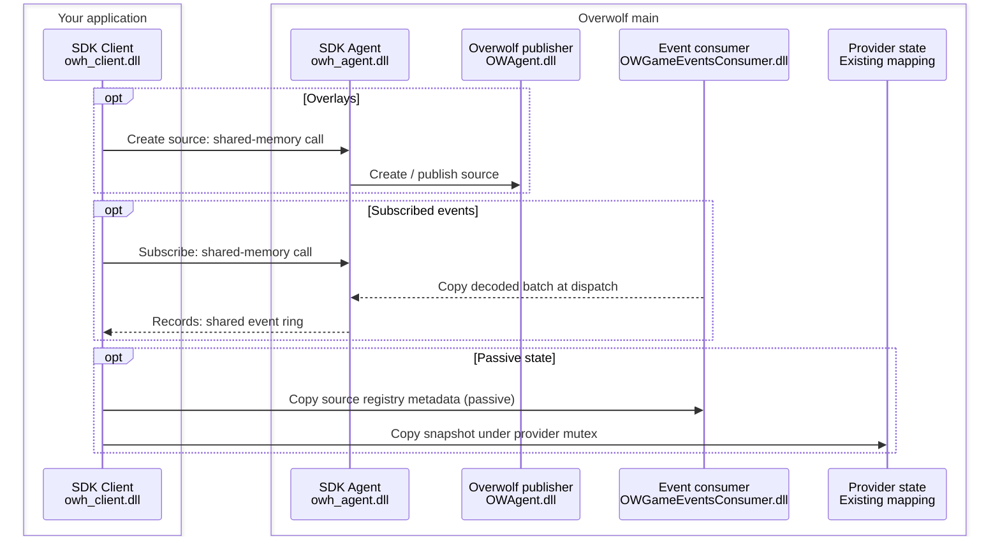

# How it works

Understand which part of the SDK runs in your application, what its Agent does
inside Overwolf, and how the three feature paths differ. For source locations, private startup mechanics, and model generation, see
[SDK internals](development/internals.md).

## Processes and responsibilities

Your C++/Java/Kotlin controllers delegate to the same C ABI in `owh_client.dll`.
Overlays and events use a session with `owh_agent.dll` in Overwolf main.
Passive state reads bypass that Agent. The SDK never accesses the game process;
Overwolf owns the downstream IPO/OOPO renderer. See [attach modes](reference/contracts.md#attach-modes)
for restart/HOT behavior before connecting.

The two similarly named DLLs are different modules in the **same Overwolf main
process**. `owh_agent.dll` is this SDK's injected integration (called the SDK
Agent in API names). `OWAgent.dll` belongs to Overwolf and implements its native
overlay publisher. No separate SDK Agent process is created.

These are the module boundaries and feature paths:

This diagram shows control and event delivery. Image buffers are shown separately
in [pixel-buffer submission](overlays/pixel-buffers.md) and [shared-texture binding](overlays/shared-textures.md);
they are not fields inside service requests. Provider state is grouped with
Overwolf by logical ownership; its Windows mapping can be opened by the Client.

The Client calls the Agent to create and manage overlays or subscriptions.
Boost.Interprocess supplies shared-memory regions and synchronization. Images
follow their own transfer contract; they are not encoded into control requests.

For events, the capture hook copies the decoded batch at Overwolf's event
dispatcher in `OWGameEventsConsumer.dll`, then calls the original dispatcher.
The Agent publishes the copies once into a bounded shared ring; each
subscription reads with its own cursor. No subscription means no capture/export.

For state, the Client reads source associations and decoding metadata from
Overwolf main, copies a bounded snapshot under the provider's mutex, then closes
the mapping handles and decodes the values. Classic named mappings can also be
read directly. It neither starts a
provider nor contacts the Agent. Provider storage is grouped with Overwolf in
the diagram by logical ownership, not a promise about every game's producer.

The overlay publisher passes a native source to Overwolf. Overwolf chooses IPO
inside the game or OOPO in `ow-overlay.exe`; the SDK uses neither renderer
directly. See the [pixel-buffer ownership sequence](overlays/pixel-buffers.md) or
[shared-texture binding boundary](overlays/shared-textures.md) for the actual image path.

## Explore a feature path

Follow the guide for the flow you want to understand:

- [Event data and delivery](game-events/data-model.md) explains the captured
  records, shared ring, and subscription lifetime.
- [Pixel-buffer submission](overlays/pixel-buffers.md) explains writable shared pixel-buffer slots
  and publication ownership.
- [Shared-texture binding](overlays/shared-textures.md) explains one
  completed shared allocation and its experimental limits.
- [Game-state reads](game-state/reading-state.md) explains discovery and passive
  provider snapshots.

For connection effects and ownership across those features, see
[connections and resource lifetime](reference/contracts.md).
