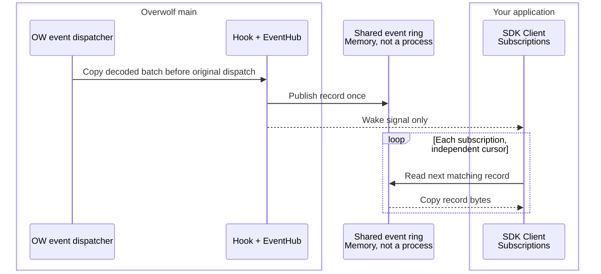

# Event data and delivery

Use events to react when a game's provider reports a change or occurrence. A **provider** is the Overwolf component that supplies game information. The SDK copies event records that Overwolf already reads and delivers them to your application. The event names and contents depend on that provider; the SDK does not turn them into a common game-data schema.

To start receiving records, follow [event subscription and reading](index.md). The context-bound `EventController` uses the attached SDK context to reach the resident Agent. Subscribing does not start a provider or enable information it is not supplying.

## Understand a received event

Each event record contains the original bounded raw bytes and metadata about
their capture and delivery. The generated JVM record owns a copy of its data.

Use these metadata fields to interpret a stream:

- `sourceChannel` / C `source_channel` identifies the data source.
- `producerProcessId` / C `producer_process_id` distinguishes producers on the
  same channel. This is an identity reported by Overwolf; the SDK does not open
  that producer's process.
- `sequence` identifies a publication in the shared event ring. It is not an
  event name, game ID, or per-channel event count.
- `lostBefore` / C `lost_before` counts known SDK losses before this record;
  [live delivery](#live-delivery) explains its limits.
- `capturedQpc` / C `captured_qpc` is the Windows performance-counter reading
  when the SDK copied the event, not the game's event time.

For example, a record with `sourceChannel = 42` and `sequence = 100` means
publication 100 in the SDK ring came from source 42. It does not mean event
100 for game 42. Select channels from discovery; these numbers are illustrative.

A **source channel** is a number identifying one available data source. It is not the public Overwolf game ID. The default subscription uses channel zero to receive all channels observed
by the Overwolf dispatcher; no discovery step is required for the first example.
For an optional channel filter, use the passive `GameStateController.sources()`
query (`owh_game_state_sources` in C). Its `OWH_CHANNEL_EVENTS` flag identifies
channels with event mappings; `OWH_CHANNEL_INFO` identifies state mappings.
See [source discovery](../game-state/reading-state.md#read-the-available-fields).
Mapping presence does not prove the channel is producing events.

If multiple producers share a channel, set `producer_process_id` in C
`owh_event_options`, or `EventOptions.setProducerProcessId(...)` in Java/Kotlin,
using a discovered source's PID. Zero accepts all producers. The channel and
producer filters apply together; neither enables a provider feature.

Treat the entire raw range as provider data. Do not assume text encoding, JSON, or a universal name/payload schema. Keep the bytes for decoding according to your game's provider. The record reserves a bounded raw area; `raw_size` gives the meaningful byte count. Exact fields are in the [event record](../reference/data-records.md#owh_event); operations are in the [event C ABI](../reference/c/events.md).

The capture counter uses Windows' high-resolution
[Query Performance Counter (QPC)](https://learn.microsoft.com/en-us/windows/win32/sysinfo/acquiring-high-resolution-time-stamps).
`EventSubscription.info()` supplies `qpcFrequency` (ticks per second)
and a clock anchor, `startedQpc` with `startedUtcFiletime`, for relating capture
ticks to wall-clock time. [FILETIME](https://learn.microsoft.com/en-us/windows/win32/api/minwinbase/ns-minwinbase-filetime)
uses 100-nanosecond intervals since
1601-01-01 UTC. These describe the SDK's observation time, not a game-supplied
timestamp. C uses the corresponding `snake_case` field names.

## Find your game's event definitions

Start with Overwolf's [Game Events Provider overview](https://dev.overwolf.com/ow-native/live-game-data-gep/live-game-data-gep-intro/)
and select your game under **Supported games**. Each game reference groups data
into features and lists its events and info updates, with examples. For instance,
the [League of Legends reference](https://dev.overwolf.com/ow-native/live-game-data-gep/supported-games/league-of-legends/)
includes a `kill` feature.

Use those pages to understand the game's data. Their setup instructions target
app packages that run inside Overwolf. This SDK instead copies records that the
installed Overwolf desktop client is already reading. Its
raw record bytes are not guaranteed to match the public GEP API's
JavaScript objects. Inspect the records received for your game before using a
documented example as a decoding schema.

## Live delivery

The Agent writes each captured record into one shared ring, a fixed-size
buffer accessible to the Clients. Each subscription reads it at its own
position, called a cursor. Wake signals tell a waiting Client to check the ring;
they do not carry record bytes:

The dispatcher belongs to `OWGameEventsConsumer.dll`; the hook and EventHub belong to
`owh_agent.dll`. Subscribers read through the SDK Client in their own process.
The ring sits outside the process boxes because it is shared memory, not
another process. Separate applications can subscribe independently too.
Clients read the ring on poll/receive even if no wake signal is pending.

The Agent uses one shared ring capped at 4 MiB including metadata and at most 64 slots. Hook ingress is capped at 1 MiB and at most 16 entries. There is no replay: a new subscription starts at its next publication. Capture stops when no subscription is active. Each subscription consumes its own matching events.

A slow subscription can fall behind while newer records overwrite older ones. `lostBefore` in JVM (or `lost_before` in C) carries global ingress and ring loss to the next matching event. Since ingress loss cannot be assigned to a channel, a filtered subscription's value is conservative and may include losses for other channels. No loss count is reported until a later matching event arrives. The SDK cannot measure losses in Overwolf or the game before its hook.

## Handle a quiet or stopped stream

No data, timeout, stream closure, and cancellation are different results:

- `NO_DATA` means a poll found no new record.
- `BUSY` means a poll could not acquire the ring's synchronization immediately; retry later if the record is still needed.
- A receive timeout means nothing arrived within that wait; you can receive again.
- `CLOSED` means the subscription ended; there is no retained drain guarantee.
- Cancellation applies to the wait using the supplied token. Signal and join that wait before closing the token.

Closing a subscription ends its live stream. A quiet stream alone does not establish that the subscription failed; check the provider and selected channel as described in [troubleshooting](../troubleshooting.md).

## Interrupted shared-memory access

Boost's Windows spin mutex does not recover ownership if a process dies while holding
it. A client crash at that point can leave the shared event ring unavailable:
poll reports `BUSY`, bounded receive times out, and an indefinite receive still
needs explicit cancellation. Restart Overwolf to replace the ring. The SDK does
not force-unlock shared memory or promise automatic recovery from that failure.

## Combine events with current values

A state **snapshot** copies the provider's available values at read time. An
**event** reports an individual change or occurrence. Use snapshots to read
available values and events to react to incoming reports; neither establishes
that the other is up to date.

State reads are passive and need no Agent attachment. Discovery can find a
source that disappears before the read. A successful snapshot does not by
itself prove a live match or recent update.

There is no shared transaction or sequence that pairs a snapshot with an event.
Event `sequence` orders SDK ring publications; `capturedQpc` records SDK capture
time. Neither establishes when a provider field last changed. Field values
and producer ticks retain their provider-specific meaning.

If you combine state and events, decide how your application correlates them
and when it treats information as stale. See [read game state](../game-state/reading-state.md).
