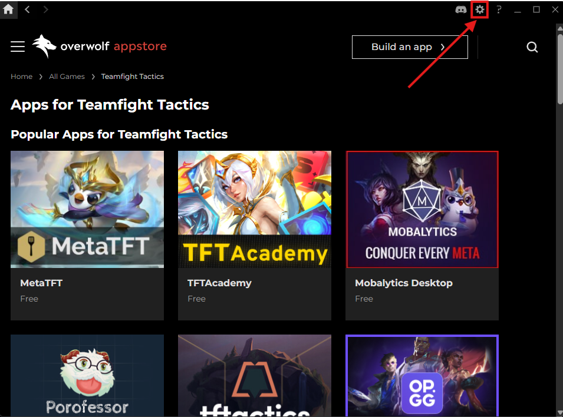
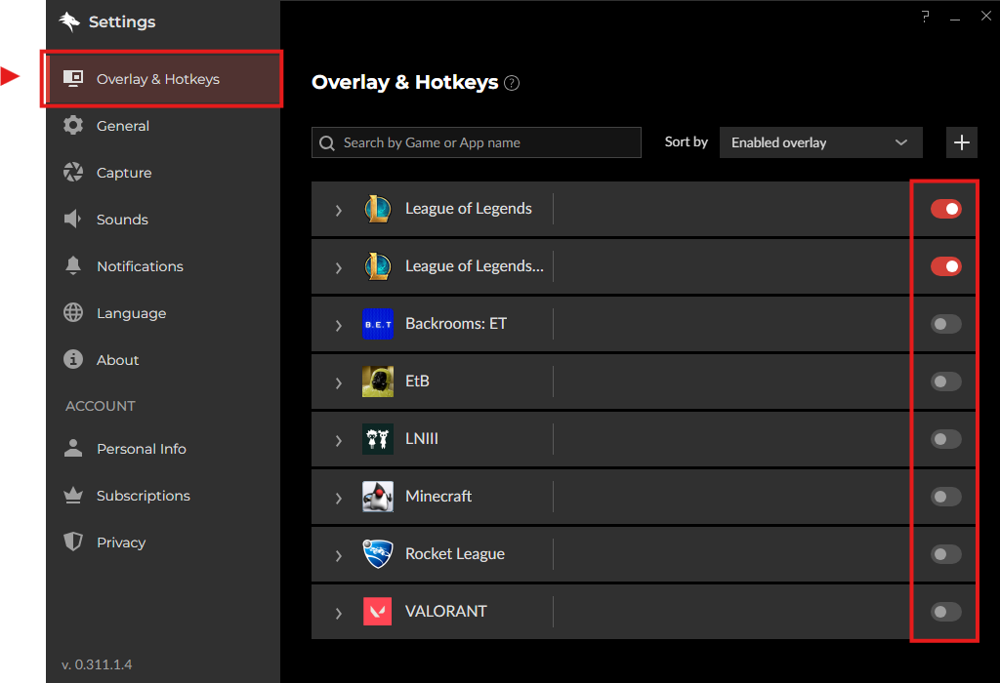

# Add Overwolf Hook to your application

Add the library to your existing Windows application with CMake or Gradle. Your
build downloads the chosen release automatically. You do not need to download an
SDK archive yourself or start from an example project.

Your application keeps its own runtime and build process; no separate
Overwolf-platform app package is part of this setup. The installed Overwolf
desktop client supplies the game integration used by live features.

## Before you begin

Use **Windows x64** and install the x64
Visual C++ Redistributable. For C/C++, use CMake 3.25 or newer and a Windows C/C++
toolchain. The C example uses C17; the C++ facade requires C++20. Java and Kotlin
require JDK 25; set `JAVA_HOME` to that JDK. Your first
build needs internet access to fetch the library and any other dependencies.

The dependency examples contain this documentation's release version. It is
filled automatically when the site is built for a release; copy the rendered code
and keep that version pinned in your application. You do not need to resolve a
"latest" version every time your application builds.

## Add the dependency

1. Add the dependency configuration for your application's language.
2. Link the SDK or enable JVM native access as shown in the same tab.
3. Continue to [the load check](#check-that-the-library-loads) before using a live feature.

C++ uses a header-only facade over the same C ABI operations.
The Java and Kotlin tabs use **Gradle Kotlin DSL**: build configuration in
`settings.gradle.kts` and `build.gradle.kts`, regardless of your application's
source language. If your project uses Gradle Groovy DSL (`.gradle` files),
translate the configuration to that syntax; the SDK does not require Kotlin DSL.

=== "C"

    Add this to your `CMakeLists.txt`, after `project(...)`:

    ```cmake
    --8<-- "docs/assets/generated/integration/native/CMakeLists.txt:dependency"
    ```

    FetchContent downloads and extracts the compiled Windows SDK during CMake
    configuration. `find_package` then makes its targets available. This does not
    build the library from source or change your application's compiler settings.

    Link your executable and deploy the library DLLs with the SDK's CMake helper. Replace `my_app`
    with your existing executable target. For a C++ target, keep your C++ standard
    setting instead of the `c_std_17` line:

    ```cmake
    --8<-- "docs/assets/generated/integration/native/CMakeLists.txt:link"
    ```

    Keep both DLLs from the same release together when distributing your application.
    `overwolf_hook_deploy_runtime` copies the matching pair beside your executable
    after the build.
    The client DLL runs in your application; the other DLL provides its integration
    inside Overwolf when you use overlays or event capture.

    [Complete CMake example](../assets/generated/integration/native/CMakeLists.txt)

=== "C++"

    In a CMake project with `project(my_app LANGUAGES CXX)`, add the
    dependency block after `project(...)`:

    ```cmake
    --8<-- "docs/assets/generated/integration/native/CMakeLists.txt:dependency"
    ```

    Declare your C++ target and link the facade:

    ```cmake
    add_executable(my_app main.cpp)
    target_compile_features(my_app PRIVATE cxx_std_20)
    target_link_libraries(my_app PRIVATE OverwolfHook::Cpp)
    overwolf_hook_deploy_runtime(my_app)
    ```

    `OverwolfHook::Cpp` supplies the resource-owning C++ facade and links the Client.
    Keep both matching DLLs beside your executable. See the [C++ API
    reference](../reference/cpp-api.md) for the facade classes.

=== "Java"

    Add this repository configuration to `settings.gradle.kts`. If you already
    have a `dependencyResolutionManagement` block, merge its `repositories` contents:

    ```kotlin title="settings.gradle.kts"
    --8<-- "docs/assets/generated/integration/jvm/settings.gradle.kts"
    ```

    Add the dependency to your module's `build.gradle.kts`:

    ```kotlin
    dependencies {
        implementation("dev.sxlver.native:overwolf-hook:{{ sdk_version }}")
    }
    java { toolchain.languageVersion.set(JavaLanguageVersion.of(25)) }
    ```

    Gradle downloads the JAR and its matching Windows DLLs automatically. The custom
    repository uses Gradle's Ivy format to read GitHub release files; no separate
    account is needed. Ordinary dependencies still come from Maven Central.

    Enable native access on your application JVM. With Gradle's `application` plugin:

    ```kotlin
    application {
        applicationDefaultJvmArgs = listOf("--enable-native-access=ALL-UNNAMED")
    }
    ```

    Append that flag to any existing JVM arguments. For another launcher, add
    `--enable-native-access=ALL-UNNAMED` to its JVM options instead.

    [Complete Java build example](../assets/generated/integration/java/build.gradle.kts)

=== "Kotlin"

    Add this repository configuration to `settings.gradle.kts`. If you already
    have a `dependencyResolutionManagement` block, merge its `repositories` contents:

    ```kotlin title="settings.gradle.kts"
    --8<-- "docs/assets/generated/integration/jvm/settings.gradle.kts"
    ```

    In your Kotlin JVM module, add:

    ```kotlin
    dependencies {
        implementation("dev.sxlver.native:overwolf-hook-kotlin:{{ sdk_version }}")
    }
    kotlin { jvmToolchain(25) }
    ```

    Gradle also downloads the Java core, matching Windows DLLs, Kotlin standard
    library, and coroutine dependencies. You do not need to list those separately.
    The custom repository reads GitHub release files using Ivy metadata; no separate
    account is needed. Keep your existing Kotlin JVM plugin; the complete example
    uses Kotlin 2.4.0.

    Enable native access on your application JVM. With Gradle's `application` plugin:

    ```kotlin
    application {
        applicationDefaultJvmArgs = listOf("--enable-native-access=ALL-UNNAMED")
    }
    ```

    Append that flag to any existing JVM arguments. For another launcher, add
    `--enable-native-access=ALL-UNNAMED` to its JVM options instead.

    [Complete Kotlin build example](../assets/generated/integration/kotlin/build.gradle.kts)

## Check that the library loads

Build for x64 and run a small load check before connecting to Overwolf. This checks
your dependency and native-library setup.

1. Save the source at the path shown for your language.
2. Select that entry point in the build configuration.
3. Build the application.
4. Run the program. Successful completion with exit code `0` confirms the local
   library loaded; continue to a feature guide only after this succeeds.

The check does not need a game or a running
Overwolf process, and it does not create an overlay or start collecting events.

=== "C"

    Save this as `main.c` in the [complete CMake example](../assets/generated/integration/native/CMakeLists.txt),
    or use the same call in your application:

    ```c
    --8<-- "docs/assets/generated/integration/native/main.c"
    ```

    For the complete example with Visual Studio 2022:

    ```powershell
    cmake -S . -B build -G "Visual Studio 17 2022" -A x64
    cmake --build build --config Release
    ./build/Release/my_app.exe
    ```

    Visual Studio 2026 uses `Visual Studio 18 2026` and requires CMake 4.2 or newer.

=== "C++"

    With the [C++ dependency setup](#add-the-dependency), save this as `main.cpp`:

    ```cpp
    --8<-- "docs/assets/examples/cpp/sdk_check.cpp"
    ```

    Build and run this C++ application:

    ```powershell
    cmake -S . -B build -G "Visual Studio 17 2022" -A x64
    cmake --build build --config Release
    ./build/Release/my_app.exe
    ```

    This opens only the local SDK context; it does not attach to Overwolf.

=== "Java"

    Save this as `src/main/java/SdkCheck.java`:

    ```java
    --8<-- "docs/assets/generated/integration/java/SdkCheck.java"
    ```

    Run it using your application's launcher with native access enabled. The
    [complete build example](../assets/generated/integration/java/build.gradle.kts) sets this
    main class, so a project using it can run `./gradlew.bat run`.

=== "Kotlin"

    Save this as `src/main/kotlin/SdkCheck.kt`:

    ```kotlin
    --8<-- "docs/assets/generated/integration/kotlin/SdkCheck.kt"
    ```

    [Download `SdkCheck.kt`](../assets/generated/integration/kotlin/SdkCheck.kt).

    Run it using your application's launcher with native access enabled. The
    [complete build example](../assets/generated/integration/kotlin/build.gradle.kts) sets this
    main class, so a project using it can run `./gradlew.bat run`.

The C example reads the ABI version. The Java and Kotlin examples open and close an SDK context. On the JVM, `open()`
extracts the bundled DLLs and loads the client. Loading alone does not connect to
Overwolf. If it fails, see [local loading troubleshooting](../troubleshooting.md#fix-local-library-loading).

<a id="what-the-load-check-means"></a>
## Prepare Overwolf for live use

!!! warning "Default attach can restart Overwolf"

    Adding the dependency and running the local load check are passive. Later,
    `attach()` can close and relaunch Overwolf, so attach before entering your
    game. See [attach modes](../reference/contracts.md#attach-modes) for the
    restart behavior and advanced HOT option.


Install Overwolf using its [official setup guide](https://support.overwolf.com/support/solutions/articles/9000184345-how-to-get-started)
if it is not installed yet. The default SDK attach starts Overwolf when it is
absent and may request a running instance to close and relaunch. Have Overwolf
and the compatible game running after attach for live data. Available data
depends on what the game's provider exposes; the library does not make
unsupported game data available.

For overlays, also enable Overwolf's overlay for your game:

1. Open Overwolf **Settings** from the gear icon.

    

2. Open **Overlay & Hotkeys**.
3. Enable the overlay for the game.

    

The setting names may differ between Overwolf versions. Enabling the overlay does
not enable additional game-data features.

## Use a feature

- [Display your own overlay](../overlays/first-overlay.md).
- [React to game events](../game-events/index.md).
- [Read available game state](../game-state/reading-state.md).
- [Find, start or stop Overwolf](../overwolf.md).

If you prefer a complete starting project, the optional [C](../downloads/native-starter.zip),
[Java](../downloads/java-starter.zip), and [Kotlin](../downloads/kotlin-starter.zip) starters include
build configuration and a working overlay example. They use the same library as
your own project.
