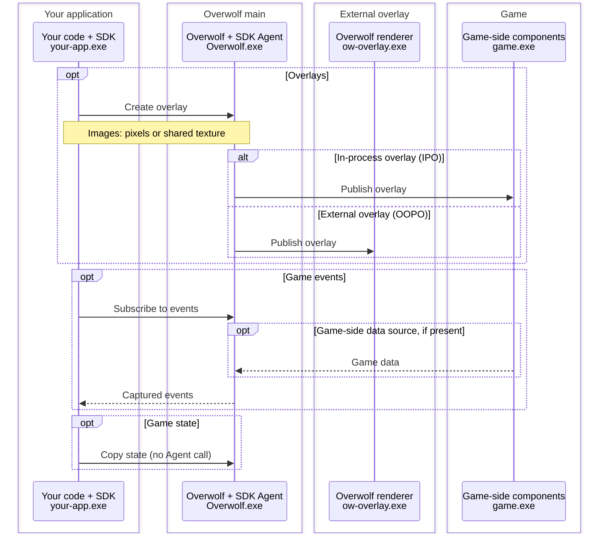

# Overwolf Hook

Use Overwolf's game events, game state, and overlays in your own **C, C++, Java,
or Kotlin application**. Your program runs separately from Overwolf, without an
Overwolf developer account or an approved Overwolf-platform app.
**The Overwolf desktop client is still required.**

[Install the SDK](getting-started/installation.md){ .md-button .md-button--primary }

Add the dependency through CMake or Gradle. You can use your existing project;
the optional [C](downloads/native-starter.zip), [Java](downloads/java-starter.zip),
and [Kotlin](downloads/kotlin-starter.zip) starters provide small starting projects.

## Choose a feature

Follow the guide for the feature you need:

| Feature | Start here |
| --- | --- |
| **Game events:** react to changes and occurrences reported by the game's integration | [Subscribe and receive events](game-events/index.md) |
| **Overlays:** display images from your own renderer over a game | [Build your first overlay](overlays/first-overlay.md) |
| **Game state:** read a snapshot of the values Overwolf already has | [Read available game state](game-state/reading-state.md) |

For local installation, version, and process control, see [Manage Overwolf](overwolf.md).

## Requirements

Before using a live feature, check these requirements:

- **Windows x64** with the x64 Visual C++ Redistributable.
- **Overwolf installed** and a compatible game for live game features.
  Enable Overwolf's overlay for that game to display your content.
- **Java 25** if you use Java or Kotlin. Native compiler and build requirements
  are listed in [SDK installation](getting-started/installation.md#before-you-begin).

Game data depends on Overwolf's game-specific integration, called a **provider**.
The SDK reads data the provider already supplies; it does not start providers
or add game support. Available fields and their freshness vary. See
[event data and delivery](game-events/data-model.md) for the distinction between
events and state snapshots.

!!! warning "Attach before entering the game"

    For overlays and events, default `attach()` can close and relaunch Overwolf.
    Attach first, then start the game. Detach does not stop Overwolf. See
    [connections and lifetime](reference/contracts.md#attach-modes) for the
    restart behavior and the riskier explicit HOT alternative.

## How the parts fit together

The SDK Client runs in your application. Overlays and event subscriptions connect
to the SDK **Agent**, `owh_agent.dll`, inside Overwolf's main process. State reads
copy existing shared data without an Agent connection. You can use each feature
independently.

The diagram shows process boundaries. Every SDK connection ends at Overwolf;
Overwolf owns the game-side integration and both overlay display paths:

SDK control calls and captured event delivery use shared memory. Images have their own
[pixel-buffer or shared-texture handoff](overlays/index.md), separate from control
requests. The diagram groups the shared state with Overwolf by ownership;
the Client opens that storage directly. Game-side components depend on the game
and display mode; the data source can be the game itself or an Overwolf provider.
The arrows describe
integration boundaries, not pixel copies or a required startup sequence.

**Game-process access belongs to Overwolf's integration. The SDK never opens,
patches, or injects into it.** See
[how it works](architecture.md) for module boundaries and
[connections and lifetime](reference/contracts.md) for the API lifecycle.

??? info "When is a standalone SDK useful?"

    A personal tool or an overlay shared with friends may not need the full
    [Overwolf app development and release process](https://dev.overwolf.com/ow-native/getting-started/release-your-app/).
    That process includes developer registration, app approval, packaging,
    and QA; its [guidelines](https://dev.overwolf.com/ow-native/getting-started/guidelines-and-requirements/)
    exclude apps intended only for personal use or a closed group.

    This SDK lets you keep your own language, UI, renderer, build system, and
    release process. It uses private Overwolf internals, so Overwolf updates can
    affect compatibility. This independent integration does not provide the
    official platform's review, Appstore distribution, or developer support.

## Reference and help

Use these pages when you need more detail:

- **API reference:** [C ABI](reference/native-api.md), [C++](reference/cpp-api.md),
  [Java](reference/java-api.md), and [Kotlin](reference/kotlin-api.md).
- **Troubleshooting:** [missing data, connection failures, or invisible overlays](troubleshooting.md).
- **SDK development:** [internals](development/internals.md) and
  [contributor instructions](https://github.com/SteveOberst/Overwolf-Hook/blob/main/CONTRIBUTING.md).
