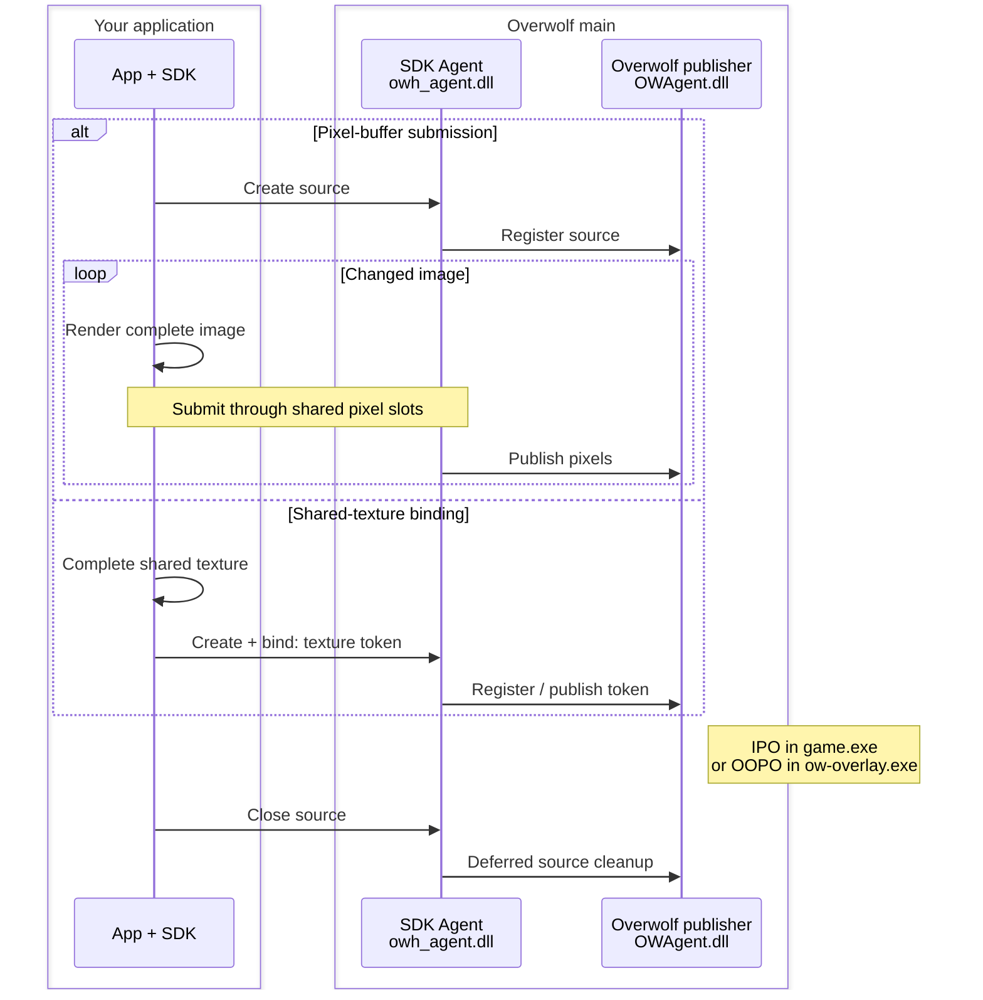

# Display your own overlay

Render an image in your application and hand it to Overwolf for display over a
compatible game. This lets an existing native or JVM renderer supply an overlay
without developing a separate UI in an Overwolf-platform app or submitting that
app for approval. You choose the renderer and when it produces an image. The
SDK creates a native overlay source: an image source that Overwolf registers
and displays. The Overwolf desktop client must be installed, with its overlay
enabled for the game.

A source has a lifetime separate from its image: **create, supply, close**.
Pixel-buffer submission creates a source before repeated `submit` calls.
Shared-texture binding creates the source and binds a completed texture together.
The source owns the image's fixed position and size. Overwolf handles the later
transport and drawing through its in-process overlay (IPO) or separate overlay
process (OOPO).

## Choose how to hand off the image

The SDK offers **pixel-buffer submission** and **shared-texture binding**.
The practical difference is **copying finished pixels through system memory**
or **sharing an existing GPU texture without that pixel copy**. These names
describe the handoff, not where you render: using a GPU renderer does not
require choosing shared-texture binding.

In pixel-buffer submission, your application supplies an image in system
memory (DRAM). The SDK copies it into shared DRAM slots that its Agent reads
inside Overwolf. You can reuse your input buffer after `submit` returns.
If your renderer produces a GPU texture, you first need a **readback**: copying
the finished image from GPU-accessible storage into a buffer your application
can read. Overwolf handles the later image transport and any upload needed
to draw it.

In shared-texture binding, your application supplies access to one existing
GPU allocation. On a dedicated GPU, its pixels normally live in video memory
(VRAM). The SDK sends a texture token and adapter identity, rather than copying
the image through DRAM. Overwolf opens the same allocation. This is the
**zero-copy handoff**: no SDK bitmap copy and no GPU-to-DRAM readback for the
traced Overwolf D3D11 consumer. It does not mean that composition or every
downstream Overwolf backend is copy-free. See
[what sharing avoids](shared-textures.md#copies-and-shared-allocation).

Compare the handoff contracts:

| Criterion | [Pixel-buffer submission](pixel-buffers.md) | [Shared-texture binding](shared-textures.md) |
| --- | --- | --- |
| What you supply | A complete BGRA8 image in your renderer buffer | A completed, shareable D3D11 texture that you own |
| SDK handoff | `submit` copies rows into SDK-owned shared pixel-buffer slots | The factory binds a token and adapter ID; Overwolf opens the same allocation |
| Memory traffic | Full image bytes cross shared DRAM on each submission; GPU output needs readback first | Binding transfers metadata; the image stays in the shared graphics allocation |
| Repeated updates | Submit complete images; latest-image delivery by default | One binding per source; no safe later-write protocol |
| Coordination | SDK-managed slot ownership; a slot is not reused while being read | No notification that Overwolf has finished reading or that rewriting is safe |
| Availability | Normal pixel-buffer source path | Experimental opt-in; D3D11 import and Overwolf renderer support must work |

Start with pixel-buffer submission for changing content or a renderer that
already returns an image in DRAM. The SDK manages publication and slot
ownership. Large, frequent submissions cost memory bandwidth; submitting a
GPU-rendered image also adds readback and potentially a later upload.
Transparent pixels still count toward each submitted image; use a source sized
for your content and [avoid unnecessary submissions](pixel-buffers.md#limit-the-amount-of-image-data).
If your renderer reports changed pixels, an optional
[damage rectangle](pixel-buffers.md#limit-overwolfs-copy-to-changed-pixels) can
reduce Overwolf's retained image copy. The SDK still submits a complete image.

Choose shared-texture binding when you already have a compatible D3D11
allocation and can keep its image unchanged until the source closes. Avoiding
readback is useful, but this experimental raw binding does not provide the
consumer synchronization needed for a general animated-texture loop. A GPU
renderer with changing content can still use pixel-buffer submission.

DRAM and VRAM explain storage, not a choice between CPU and GPU rendering.
On an integrated GPU, a graphics allocation can use system memory too; sharing
still avoids the explicit bitmap copy. Both routes share resources between
processes, and neither creates a rendering engine for you.

## Create, supply, close

Open an `OverwolfHook` context, [attach](../reference/contracts.md#attach-modes),
then use its `OverlayController`: `sdk.overlays()` in C++/Java or `sdk.overlays`
in Kotlin. Default attach can close and relaunch Overwolf, so attach before
entering the game.

Pixel-buffer sources accept repeated images; a shared-texture source binds one
completed allocation. Their lifecycle is:

The diagram distinguishes source-control calls from shared pixel slots and
the texture token. The detailed transfer guides explain ownership and timing.
The SDK
connects only to the Overwolf main process; the renderer branches belong to
Overwolf. Your application does not need separate IPO/OOPO code.
The same lifecycle has different operations for each transfer:

| Operation | pixel-buffer source | shared-texture source |
| --- | --- | --- |
| Create | `createPixelBuffer(spec)` allocates the shared slots and registers a native source | `createSharedTexture(spec, texture)` creates and binds a completed texture |
| Supply image | `submit(image)` copies into shared slots; optional first-in, first-out (FIFO) delivery waits for capacity | The factory binds and registers one completed texture |
| Observe | Optional submission receipt reports the native publication outcome | Successful bind and `READY` report source acceptance |
| Close | Stop publishing; release the local source handle | Close the source before releasing your texture allocation |

The operation table uses Java/Kotlin spelling; C++ uses `create_pixel_buffer` and
`create_shared_texture`. C exposes the same operations through the [C ABI](../reference/native-api.md).

Geometry is in physical pixels and remains fixed. Close and recreate to move or
resize. Sources are click-through; this API does not deliver mouse or keyboard
input. There is no hide/show operation. For a pixel-buffer source, publish a complete
transparent image to clear its visible content while keeping it registered.

## Readiness and outcomes

`capabilities()` checks the source paths in the attached Overwolf process. Its
`pixelBufferStatus` and `sharedTextureStatus` fields report readiness for
pixel-buffer submission and shared-texture binding;
`available` and `enabled` distinguish readiness from your experimental opt-in.
The query does not create a window or import a texture. Create/bind still perform
their own checks, and Overwolf's overlay must be enabled for the compatible game.

Keep these results separate:

- A successful pixel-buffer **submission** means the image was queued.
- A receipt in **PUBLISHED** means the native publish call succeeded.
- A successful texture **bind** means the native source accepted that texture.

None confirms that the image was displayed on screen. A receipt timeout ends
only the wait, and closing a receipt does not cancel its image. Your application
owns its render cadence; there is no render-tick callback or built-in frame loop.
Publish only when your content changes. The SDK does not compare images for you.

Start with [your first overlay](first-overlay.md), then the relevant
[pixel-buffer submission](pixel-buffers.md) or
[shared-texture binding](shared-textures.md) guide.
