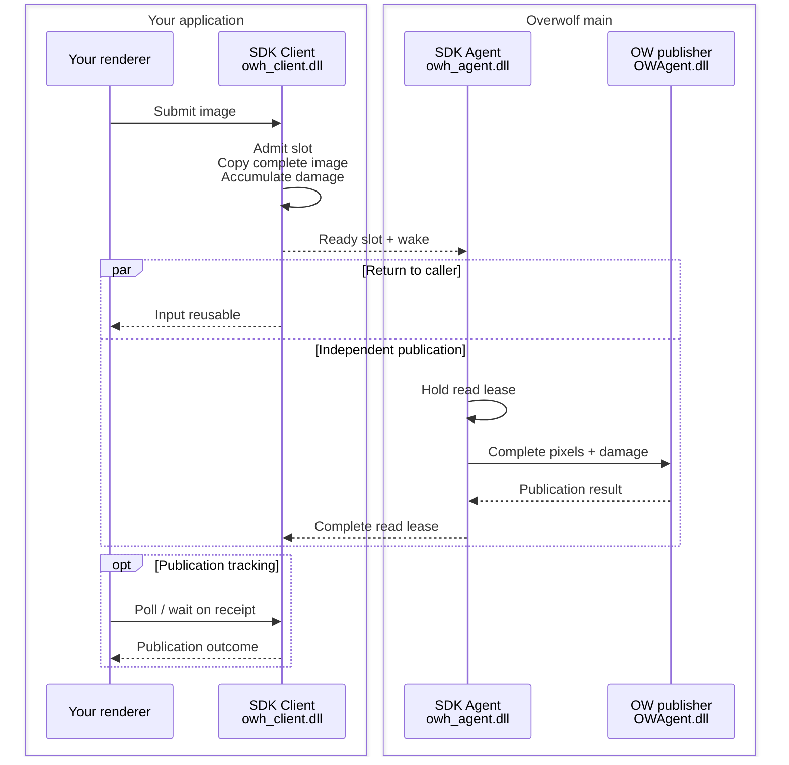

<a id="shared-memory-images"></a>
# Submit pixel buffers

Render a complete image in your application, then call `submit` to hand it to
Overwolf. The SDK copies its rows into shared pixel-buffer slots and manages
publication. You can reuse your renderer buffer as soon as the call returns.

This guide draws an orange square, submits it, and moves it with a second
complete image. It uses no rendering framework or SDK frame scheduler. The
optional delivery policies and direct-write interface are explained after the
normal drawing and submission steps.

**Pixel-buffer submission copies finished pixels through system memory
(DRAM).** Your image can come from software rendering or a GPU renderer. For
a GPU renderer, finish rendering and read the image back into an accessible
pixel buffer before calling `submit`. This readback moves the image from its
GPU allocation, normally VRAM on a dedicated GPU, into DRAM. It can add a wait
for GPU completion as well as the data transfer.

The normal flow is your renderer's image buffer → SDK shared DRAM slot →
Overwolf's native publisher → Overwolf's display path. The Client copies the
image into the slot; the Agent reads that same slot without a second SDK
image copy. Overwolf owns any later copy, upload, or drawing. Returning from
`submit` lets you reuse your original buffer; it does not mean that the image
is already visible.

Each complete BGRA8 image contains `width * height * 4` bytes. At 3840 × 2160,
that is about 31.6 MiB per image, or 1.85 GiB of image payload per second at 60
submissions per second.  If you can retain an unchanged D3D11 texture, see
[shared-texture binding](shared-textures.md) for a handoff without the DRAM
bitmap copy.

## Before you begin

Complete [SDK installation](../getting-started/installation.md) and enable
Overwolf's overlay for your compatible game. Run the complete example outside
the game, then enter the game after its first image is accepted.

Default `attach()` can close and relaunch Overwolf. See
[attach modes](../reference/contracts.md#attach-modes) before running a sample
against a running session.

## Create the source

Create one pixel-buffer overlay with fixed physical-pixel geometry: width 256, height
128, left 64, and top 64. The complete programs open and attach the SDK first.
They keep the same overlay open for both images.

Use `owh_overlay_create_pixel_buffer` in C, `sdk.overlays().create_pixel_buffer(spec)` in
C++, `sdk.overlays().createPixelBuffer(spec)` in Java, or
`sdk.overlays.createPixelBuffer(spec)` in Kotlin. Set those dimensions in
`owh_overlay_spec` / `OverlaySpec`; the [complete examples](#complete-example)
include each language's setup and cleanup.

Omit `PixelBufferOverlayOptions` for the default: three shared slots and latest-image
delivery. A newer image replaces an unread one when the renderer gets ahead of
Overwolf. An in-flight read stays protected. You do not acquire slots or retry
normal capacity failures yourself.

## Draw a complete image

Allocate a tightly packed buffer of `width * height * 4` bytes once. On each
update, clear it to transparent, then draw the square. `update` is zero for the
first image and one for the second, moving the square from left to right:

=== "C"

    ```c
    --8<-- "docs/assets/examples/c/publish_bgra_updates.c:draw"
    ```

=== "C++"

    ```cpp
    --8<-- "docs/assets/examples/cpp/publish_bgra_updates_cpp.cpp:draw"
    ```

=== "Java"

    ```java
    --8<-- "docs/assets/examples/java/PublishBgraUpdates.java:draw"
    ```

=== "Kotlin"

    ```kotlin
    --8<-- "docs/assets/examples/kotlin/PublishBgraUpdates.kt:draw"
    ```

Each pixel contains blue, green, red, and alpha bytes (**straight-alpha BGRA8**).
Opaque red is `00 00 FF FF`; transparent black is `00 00 00 00`. Straight alpha
keeps color independent of alpha. If your renderer produces RGBA or
premultiplied pixels, convert them before submission; the SDK does not convert
formats.

Clearing the image removes the square's old position in the second update.
Every submission is a complete image, not a packed patch. Transparent
pixels are part of that image and are copied too. Do not skip writing them:
a shared slot can still contain visible pixels from an older image.

## Submit an image

Call the SDK directly with the image you just drew:

=== "C"

    ```c
    --8<-- "docs/assets/examples/c/publish_bgra_updates.c:submit"
    ```

=== "C++"

    ```cpp
    --8<-- "docs/assets/examples/cpp/publish_bgra_updates_cpp.cpp:submit"
    ```

=== "Java"

    ```java
    --8<-- "docs/assets/examples/java/PublishBgraUpdates.java:submit"
    ```

=== "Kotlin"

    ```kotlin
    --8<-- "docs/assets/examples/kotlin/PublishBgraUpdates.kt:submit"
    ```

The native call accepts the input pointer, byte length, and source row stride.
A zero stride selects `width * 4`. C++ accepts a `std::span<const std::byte>`;
the example's byte vector converts to that span. Java and Kotlin accept a byte
array directly. Java also accepts `ByteBuffer` or `MemorySegment`.

For padded renderer rows, pass the actual source stride: C/C++ accept it in the
same call; Java uses `submit(MemorySegment.ofBuffer(image), sourceStride)`, and
Kotlin's byte-array extension is `submit(image, sourceStride)`. Include
`import dev.sxlver.overwolfhook.kotlin.submit` for that extension. Your input
must cover `(height - 1) * sourceStride + width * 4` bytes after resolving zero
stride to `width * 4`.

`submit` returns after copying and handing off the image, so your renderer may
reuse its buffer. It does not wait for visible display. Metadata synchronization
and the copy still run on the calling thread; source loss, invalid input, and
transport failures remain errors. The SDK integration in Overwolf handles later
native-publisher retries.

## Close the source

Close the overlay when you no longer need it. In Java/Kotlin, keep it inside a
`try`-with-resources / `use` scope; C++ also provides scoped ownership. C calls
`owh_overlay_close`. Close consumes the local handle, even if it reports a
cleanup error, so do not retry that handle. Detach after your overlays close.

Physical source removal can finish later in the SDK integration. See
[ownership contracts](../reference/contracts.md#contexts-and-ownership).

## Limit the amount of image data

Transparency controls visibility, not transfer size. A mostly transparent
3840 × 2160 image still supplies the full 31.6 MiB on every submission.
The SDK does not pack visible regions or compare the image with an earlier
submission. Overwolf's pixel-buffer publisher receives a complete image.

To reduce copying, keep the source dimensions close to your content instead
of using a fullscreen transparent canvas for a small panel. Geometry is fixed
for a source; close and recreate it if the required area changes. If the image
has not changed, leave the source open without submitting another copy.

If your renderer can fill the shared slot directly, the optional
[direct-write interface](#direct-write-access-for-advanced-renderers) avoids
the copy from a separate renderer buffer. It still requires filling the
complete image, including transparent pixels, and does not reduce Overwolf's
downstream image size. Shared-texture binding avoids the DRAM bitmap handoff
for a compatible unchanged allocation; see its
[copy and lifetime limits](shared-textures.md#copies-and-shared-allocation).

## Limit Overwolf's copy to changed pixels

If your renderer already reports which pixels changed, pass an optional
**damage rectangle** with the complete image. The rectangle describes the
changed area in image-local physical pixels: `x`, `y`, `width`, and `height`.
Omit it for normal full-image publication. The SDK does not scan or hash the
image to discover changes.

For the moving square in this guide, the second image changes both its old
position and its new position. After clearing and redrawing the complete image,
submit the rectangle covering both: `(16, 32, 224, 64)`. Use the following call
instead of the second ordinary submission:

=== "C"

    ```c
    owh_pixel_region damage = {16, 32, 224, 64};
    if (!checked("submit changed image", owh_overlay_submit_pixels(
            overlay, image, sizeof(image), 0, &damage, NULL, NULL)))
        goto cleanup;
    ```

=== "C++"

    ```cpp
    const owh_pixel_region damage{16, 32, 224, 64};
    overlay.submit(image, damage);
    ```

=== "Java"

    Add the import at the top of your file:

    ```java
    import dev.sxlver.overwolfhook.model.PixelRegion;
    ```

    Then submit the image with its changed area:

    ```java
    var damage = new PixelRegion()
        .setX(16).setY(32).setWidth(224).setHeight(64);
    overlay.submit(image, damage);
    ```

=== "Kotlin"

    Add the import at the top of your file:

    ```kotlin
    import dev.sxlver.overwolfhook.model.PixelRegion
    ```

    Then submit the image with its changed area:

    ```kotlin
    val damage = PixelRegion()
        .setX(16).setY(32).setWidth(224).setHeight(64)
    overlay.submit(image, damage)
    ```

Include **every pixel changed since the last successful submission**, including
pixels cleared to transparent. The rectangle must be nonempty and fit inside
the source. Passing a small rectangle with incomplete bounds can leave old
content visible. If a submission fails, keep its changes in the next image's
rectangle, or omit the hint to publish the whole image.

The SDK combines pending rectangles so that latest-image replacement does not
lose earlier changes. It starts with the whole image and resets the accumulated
rectangle only after successful publication catches up with accepted images.
If your renderer stays ahead, this conservative rectangle can stay large. FIFO
uses the same mechanism and preserves complete accepted images in order.

This optimization has a specific scope:

| Part of the path | Effect of damage |
| --- | --- |
| Your buffer → shared DRAM slot | Still copies every pixel; the slot holds a complete image |
| Shared slot → Overwolf's retained native image | Can copy only the accumulated rectangle |
| Overwolf's display path | No smaller GPU upload guarantee; the traced D3D11 consumer still uploads the complete image |

Overwolf copies the whole image when establishing its image storage. Its normal
publisher also falls back to a whole-image copy for rectangles spanning the
full image width **or** height. A small rectangle inside a large source is the
useful case; measure the benefit in your workload.

This option applies only to pixel-buffer submission. Shared-texture binding
has no per-frame damage submission and gains no optimization from this hint.

## Choose how pending images are handled

Set optional `PixelBufferOverlayOptions` when creating the overlay:

| Behavior | Configuration | When the consumer falls behind |
| --- | --- | --- |
| Latest image (default) | Omit options, or use `OWH_QUEUE_LATEST_READY` | Replaces an unread image; never overwrites an in-flight read |
| Bounded ordered delivery | Set `policy` to `OWH_QUEUE_FIFO` | `submit` waits for a slot, preserving accepted image order |
| Immediate attempt | Call `trySubmit` / `try_submit` / `owh_overlay_try_submit_pixels` | Uses a free slot without replacing a pending image; returns false / `OWH_BUSY` when unavailable |

For example, Kotlin can select FIFO with
`createPixelBuffer(spec, PixelBufferOverlayOptions().setPolicy(OwhConstants.OWH_QUEUE_FIFO))`.
Java uses the same generated model with `new PixelBufferOverlayOptions()`.
C/C++ initialize `owh_pixel_buffer_overlay_options`, then set `policy = OWH_QUEUE_FIFO`.
The optional `slot_count` is bounded by the reported capabilities; increasing
it uses more memory and permits more queued latency. No unbounded queue is created.

FIFO is explicit backpressure: a bounded queue cannot preserve every image
indefinitely while accepting unlimited submissions without waiting. By default,
FIFO submission waits indefinitely for capacity. For finite or cancellable
admission, use:

- C: the optional `owh_wait_options` argument to `owh_overlay_submit_pixels`.
- C++: `submit(image, stride, timeout_ms, cancellation)`.
- Java: `submit(segment, stride, Duration, WaitCancellation)`.
- Kotlin: `submitCancellable(segment, stride, timeout)` from a coroutine.

A timeout or cancellation before admission leaves the image unsubmitted. After
admission, the call attempts the copy and commit; a deadline does not cancel an
image already handed off. These are admission budgets, not a guarantee that
the whole call returns within that time: shared metadata access and commit can
also wait. For the distinction from connection timeouts, see
[timeout effects](../reference/contracts.md#timeouts-and-session-loss).
Kotlin's suspending helper uses an IO thread; its
input segment must be accessible there and stay alive until the helper returns.
Use ordinary `submit` for the default latest-image route.

## Track publication when needed

Normal submission needs no receipt. Request one with `submitTracked(segment)`
in Java/Kotlin, `submit_tracked(image)` in C++, or a non-null receipt output in C.
Poll or wait for `PUBLISHED`, `REPLACED`, `REJECTED`, or `LOST`, then close the
receipt. `PUBLISHED` means the native publish call succeeded, not visible display.
The nested `SubmissionInfo.result` describes publication, separately from
whether waiting succeeded.

Close each receipt after reading its outcome. The capability field
`maximumReceiptsPerOverlay` (C `maximum_receipts_per_overlay`) limits open
receipt handles, including completed receipts. Reaching that limit makes a
new tracked submission fail with `RESOURCE_EXHAUSTED`. With latest-image
delivery, the failed call may already have replaced the previous unread image;
failure does not guarantee that the prior pending image is preserved. Ordinary
untracked `submit` does not request a receipt.

These callable helpers submit an existing image and wait up to one second for
its publication outcome. Call them after creating the overlay; they do not
draw an image or open another SDK context:

=== "C"

    ```c
    --8<-- "docs/assets/examples/c/track_publication.c"
    ```

=== "Java"

    ```java
    --8<-- "docs/assets/examples/java/TrackPublication.java"
    ```

=== "Kotlin"

    ```kotlin
    --8<-- "docs/assets/examples/kotlin/TrackPublication.kt"
    ```

Closing a receipt does not cancel its image. A wait timeout ends only the wait.
Join waits before closing their receipt or cancellation token. No SDK thread is
created per receipt.

## Direct-write access for advanced renderers

If your renderer can draw directly into the shared slot, `tryAcquire()` /
`try_acquire()` / `owh_frame_acquire` avoids copying an intermediate image.
This is optional expert access:

1. Try to acquire a writable frame. An empty result or `OWH_BUSY` means no slot
   is available; this path does not wait for capacity or replace a pending image
   for you. It can still wait briefly for shared metadata synchronization.
2. Fill the entire BGRA8 image using the returned stride. A slot does not
   necessarily contain your previous image.
3. End all pixel access, then commit or discard. Every native commit consumes
   the frame, including errors. Never reuse its pixel pointer.

An acquired frame defaults to full-image publication. To supply the same optional
damage hint before committing, use `frame.set_damage(region)` in C++,
`frame.setDamage(region)` in Java/Kotlin, or `owh_frame_set_damage(frame, &region)`
in C. Passing null resets the hint to the whole image. You still fill the entire
slot; the SDK does not preserve the previous image in each writable slot.

Serialize each overlay's operations. Finish direct borrows before calling
managed `submit`. The lower-level `owh_frame_prepare_submit` supports language
bridges that apply managed admission before copying into a scoped frame.
Under latest-image delivery, prepare can replace an unread image before commit;
discarding the new frame does not restore that image. Ordinary C callers use
`owh_overlay_submit_pixels`.

## How the image crosses the boundary

The sequence follows normal managed submission:



Image bytes live in the shared slot, not in a service request. The SDK integration
reads the slot and retries native publication if it is temporarily busy. It
releases read ownership after the native call completes. Overwolf owns the
downstream copy or upload; this is not an end-to-end zero-copy guarantee.
Publication can finish before or after `submit` returns; the receipt reports
that separate outcome.
No SDK code accesses the game process.
The optional [damage hint](#limit-overwolfs-copy-to-changed-pixels) affects the
publisher's native image copy, not the complete image stored in the slot.

## Complete example

Each program creates the source, draws and submits both images, and closes the
source before detaching. Save its complete source in the project configured
under [SDK installation](../getting-started/installation.md):

=== "C"

    [Download the complete source](../assets/examples/c/publish_bgra_updates.c).
    Save it as `main.c`.

    ??? example "Complete C program"

        ```c
        --8<-- "docs/assets/examples/c/publish_bgra_updates.c"
        ```

=== "C++"

    [Download the complete source](../assets/examples/cpp/publish_bgra_updates_cpp.cpp).
    Save it as `main.cpp`.

    ??? example "Complete C++ program"

        ```cpp
        --8<-- "docs/assets/examples/cpp/publish_bgra_updates_cpp.cpp"
        ```

=== "Java"

    [Download the complete source](../assets/examples/java/PublishBgraUpdates.java).
    Save it as `src/main/java/examples/overlays/PublishBgraUpdates.java`.

    ??? example "Complete Java program"

        ```java
        --8<-- "docs/assets/examples/java/PublishBgraUpdates.java"
        ```

=== "Kotlin"

    [Download the complete source](../assets/examples/kotlin/PublishBgraUpdates.kt).
    Save it as `src/main/kotlin/examples/overlays/PublishBgraUpdates.kt`.

    ??? example "Complete Kotlin program"

        ```kotlin
        --8<-- "docs/assets/examples/kotlin/PublishBgraUpdates.kt"
        ```

Run the native target as `my_app.exe`. For Java, set your Gradle application
entry point to `examples.overlays.PublishBgraUpdates`; Kotlin uses the same
entry point because its sample declares an object with `@JvmStatic main`.
No extra renderer dependency is required.

Confirm the result:

1. Wait for **First image accepted**, then enter the compatible game. Look for
   an orange square with transparent margins near the top left.
2. Press Enter in the sample console. The square moves to the right; its
   previous position becomes transparent.
3. Press Enter again. The source closes and the square disappears.

Acceptance does not confirm display. If nothing appears, use
[overlay display checks](../troubleshooting.md#separate-source-acceptance-from-display).

## Next steps

For exact operations, see [overlay C contracts](../reference/c/overlays.md).
For a different transfer mechanism, see [shared-texture binding](shared-textures.md).
