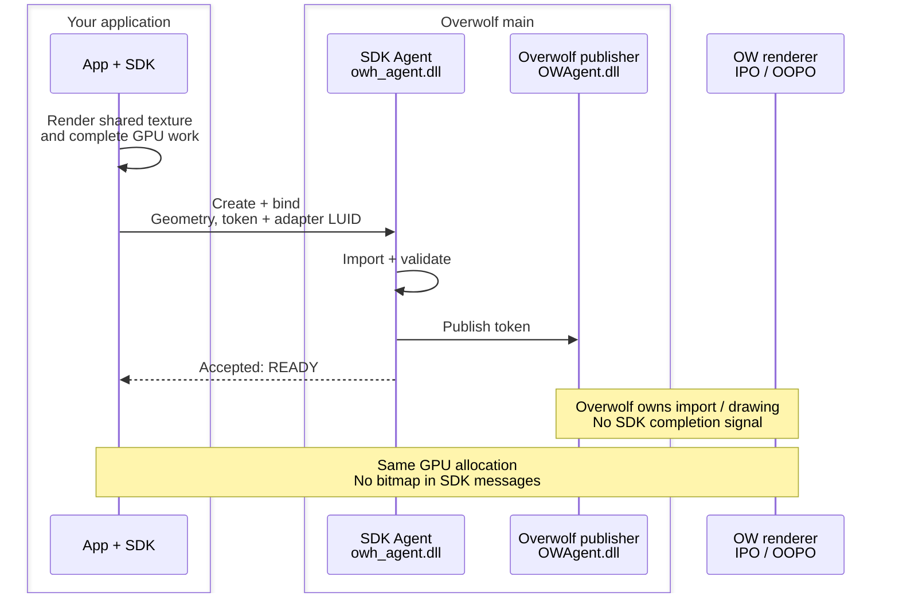

<a id="bind-a-d3d11-shared-texture"></a>
# Bind shared textures

Share a completed Direct3D 11 (D3D11) texture with Overwolf. Instead of copying
pixel data into SDK-owned shared slots, you supply the texture's legacy token and graphics
adapter identity. Overwolf imports the same graphics allocation for display.
On a dedicated GPU, its pixels normally reside in video memory (VRAM);
integrated GPUs can use system memory for the allocation. The SDK transfers
access to the image, rather than transferring the image bytes through DRAM.

This guide connects your renderer's completed texture to an overlay and keeps
it alive until close. The [complete C++ example](#complete-example) also creates
the D3D11 device and texture, draws a cyan rectangle on the GPU, and waits for
initial rendering to finish. C, Java, and Kotlin examples show the complete
SDK integration after your renderer has produced that texture.

This experimental **raw binding** exposes the allocation directly; it does not
queue GPU frames for you. Keep the image
unchanged and the allocation alive until native overlay close returns. The SDK
exposes no consumer fence (a signal that Overwolf has finished reading) or safe
point for later writes. For changing images
with defined ownership, use [pixel-buffer submission](pixel-buffers.md), including GPU
readback if required by your renderer.

## Before you begin

Complete [SDK installation](../getting-started/installation.md) and enable
Overwolf's overlay for your compatible game. Run the example before entering
the game: default attach can close and relaunch Overwolf. See
[attach modes](../reference/contracts.md#attach-modes).

For the standalone C++ example, use the Windows SDK's D3D11/DXGI headers and
libraries. For C/Java/Kotlin integration, your renderer must supply a completed
texture matching the contract in [Prepare the allocation](#prepare-the-allocation).
The SDK does not create or replace your rendering engine.

<a id="enable-and-use-the-path"></a>
## Enable the path

Open the SDK and enable the experimental feature **before** attaching. These
snippets are part of the complete samples; C checks the returned result, while
C++/JVM failures propagate as exceptions:

=== "C"

    ```c
    --8<-- "docs/assets/examples/c/bind_completed_texture.c:attach"
    ```

=== "C++"

    ```cpp
    --8<-- "docs/assets/examples/cpp/shared_texture_overlay.cpp:attach"
    ```

=== "Java"

    ```java
    --8<-- "docs/assets/examples/java/BindCompletedTexture.java:attach"
    ```

=== "Kotlin"

    ```kotlin
    --8<-- "docs/assets/examples/kotlin/BindCompletedTexture.kt:attach"
    ```

## Prepare the allocation

Create one shareable D3D11 2D texture in your renderer. Its descriptor must match
these requirements:

| Texture property | Required value |
| --- | --- |
| Dimensions | Exactly the source's width and height |
| Format | `DXGI_FORMAT_B8G8R8A8_UNORM` |
| Mips / array slices / samples | One each; sample quality zero |
| Usage / CPU access | `D3D11_USAGE_DEFAULT` / zero CPU access |
| Bind flags | Exactly `D3D11_BIND_RENDER_TARGET \| D3D11_BIND_SHADER_RESOURCE` |
| Misc flags | Exactly `D3D11_RESOURCE_MISC_SHARED` |
| Import device | Feature level 11.0 on the supplied adapter LUID |

The C++ sample creates a 256-by-128 allocation. Its complete source includes
device creation; this is the texture descriptor and allocation:

```cpp
--8<-- "docs/assets/examples/cpp/shared_texture_overlay.cpp:allocation"
```

### Render and complete the initial GPU work

Render into that allocation with your chosen engine. The sample fills it with
opaque cyan through a D3D11 render-target view:

```cpp
--8<-- "docs/assets/examples/cpp/shared_texture_overlay.cpp:render"
```

Before binding, wait for the producer's initial GPU work to complete. `Flush()`
submits commands but does not establish completion. The sample uses an event
query and a five-second deadline on its own application thread:

```cpp
--8<-- "docs/assets/examples/cpp/shared_texture_overlay.cpp:completion"
```

The [D3D11 Flush documentation](https://learn.microsoft.com/en-us/windows/win32/api/d3d11/nf-d3d11-id3d11devicecontext-flush)
explains this event-query completion pattern. The query proves that **your
initial rendering** finished; it does not tell you when Overwolf later stops
reading the texture.

## Create and bind the source

The **legacy token** identifies the existing shareable D3D11 allocation; it is
not a pointer to the pixels. Obtain it with `IDXGIResource::GetSharedHandle` and the
adapter's **locally unique identifier (LUID)** from the texture's device. The
[complete C++ program](#complete-example) includes those calls. The token is
neither a COM pointer nor an NT handle to close with `CloseHandle`; arbitrary
integers, NT-handle resources, and keyed-mutex variants do not meet this
contract. See Microsoft's [legacy shared-token contract](https://learn.microsoft.com/en-us/windows/win32/api/dxgi/nf-dxgi-idxgiresource-getsharedhandle).

Create the overlay with the texture's dimensions, token, and LUID. The normal
factory creates and binds together, closing the new source if binding fails.
The C/Java/Kotlin snippets receive these values from your renderer; the C++
sample constructs `binding` from its actual texture and device:

=== "C"

    ```c
    --8<-- "docs/assets/examples/c/bind_completed_texture.c:bind"
    ```

=== "C++"

    ```cpp
    --8<-- "docs/assets/examples/cpp/shared_texture_overlay.cpp:bind"
    ```

=== "Java"

    ```java
    --8<-- "docs/assets/examples/java/BindCompletedTexture.java:binding"
    --8<-- "docs/assets/examples/java/BindCompletedTexture.java:scope"
    ```

=== "Kotlin"

    ```kotlin
    --8<-- "docs/assets/examples/kotlin/BindCompletedTexture.kt:binding"
    --8<-- "docs/assets/examples/kotlin/BindCompletedTexture.kt:scope"
    ```

`READY` confirms native source acceptance, not visible display. Keep the overlay
open and the producer allocation alive and unchanged while Overwolf can use it.
There is no per-frame `submit` call on this raw-binding route.

## Close the source

Close the overlay before releasing the producer allocation or detaching. C calls
`owh_overlay_close`; C++ calls `overlay.close()` or ends its scope. Java's
`try`-with-resources and Kotlin's `use` close the overlay at the end of the shown
scope. The complete JVM integration samples also keep an `allocationOwner`
resource until after SDK cleanup; your renderer implements its `close()` to
release the actual texture/device references.

A returned native close error still consumes the overlay handle. Do not retry
that handle. After close returns, the SDK integration retains its own imported
references for any remaining cleanup, so you may release your producer
reference. This is a resource-lifetime rule, not a safe rewrite notification.

## Check availability and failures

Having a GPU does not establish that this route works for the current game.
The game's enabled Overwolf overlay, its chosen renderer, the graphics adapter
and resource import must all support the image path. The SDK's `sharedTextureStatus`
checks its native source entry points and lifecycle readiness, not downstream
renderer import or your texture. `available` describes that source capability;
`enabled` also accounts for your attach-time opt-in.

Overwolf's [Electron shared-texture guide](https://dev.overwolf.com/ow-electron/reference/examples/overlay/shared-texture-rendering/)
describes eligibility and automatic fallback for its own app windows. This SDK
uses the native publisher directly: it does not create an Electron/CEF window,
apply an app manifest setting, or implement that automatic fallback. Treat
create/bind results and an actual display test as separate from a readiness
query. Choose a pixel-buffer fallback in your application if needed.

The upstream guide limits its shared-texture option to D3D11/D3D12 games,
offscreen windows, and enabled hardware acceleration. Those are requirements
of Overwolf's app-window feature, not SDK settings to copy into your program.
This SDK imports a D3D11 allocation directly and does not create an app window.
Its capability query does not verify the selected game's renderer, and there
is no automatic conversion to pixel-buffer submission if binding fails.

Without opt-in, create/bind reports `OPT_IN_REQUIRED`. Adapter selection, device
creation, resource import, descriptor validation and native registration can
fail separately; preserve the result's stage and native code. The combined factory
closes its source on failure. If you use the unbound factory, close that source
when you abandon a failed bind. See [source cleanup](#close-the-source) for
producer lifetime and close-error handling.

If accepted content is not visible, use [overlay troubleshooting](../troubleshooting.md#separate-source-acceptance-from-display).

## Copies and shared allocation

The practical benefit is avoiding a GPU → DRAM → GPU bitmap round trip when
your renderer already produces a compatible texture. Pixel-buffer submission
needs that GPU output in a readable DRAM buffer, then copies it into shared
slots. Binding instead makes the existing graphics allocation accessible to
Overwolf. It does not change how your renderer draws the image.

Binding sends geometry, a token, and the adapter LUID; it sends no bitmap.
The SDK Agent opens your existing allocation with `OpenSharedResource`, checks
its descriptor, and retains a reference. It passes the original token to
Overwolf. It does not read the pixels into a DRAM buffer or upload a copied
image. Opening a shared resource gives another device access to the existing
allocation; see Microsoft's [shared-resource contract](https://learn.microsoft.com/en-us/windows/win32/api/d3d11/nf-d3d11-id3d11device-opensharedresource).

The analyzed Overwolf D3D11 widget consumer also opens that allocation and
samples it directly through a shader resource view when drawing. This avoids
the pixel readback and upload used when a GPU renderer submits a pixel buffer.
That is the scope of **zero-copy handoff** here: no SDK image copy and no
pixel readback in that traced consumer. It is not a guarantee about every
Overwolf backend or the complete OOPO
compositor. Capability checks and successful binding do not establish that a
particular game selected the analyzed consumer.

Render directly into the shareable allocation when your renderer supports it.
Rendering into a separate target and then copying to the shared texture adds
a GPU-side copy in your application. Overwolf still has to sample the image
and draw into its destination; sharing does not remove that graphics work or
provide synchronization for later writes.

## How creation and binding differ

The normal `createSharedTexture(spec, texture)` call creates and binds the source
before returning it. The SDK integration selects the supplied adapter, opens and
validates the allocation, creates/registers the native source, and passes its token
to Overwolf's shared-texture publisher. The integration retains its imported D3D11
resource. A successful call returns a `READY` source; that confirms acceptance,
not visible display.

Only if creation must precede texture allocation, use the expert
`createUnboundSharedTexture(spec)` / `create_unbound_shared_texture(spec)` /
`owh_overlay_create_unbound_shared_texture` factory. It reports `AWAITING_TEXTURE`
until `bind(texture)` succeeds. Close it if binding fails. One successful binding
is allowed per source; close and recreate for a different texture.

The sequence separates SDK acceptance from Overwolf's later display:



The Agent's validation import does not copy the image into another SDK texture.
Overwolf's renderer uses its own import downstream. IPO draws inside `game.exe`;
OOPO draws in a separate `ow-overlay.exe`. The SDK neither opens those processes
nor supplies separate integration code for them. This downstream description comes from the analyzed Overwolf behavior. The
diagram stops at the SDK acceptance boundary; it does not promise the order or success of
Overwolf's later import relative to the bind reply, or a copy-free path through
every Overwolf renderer/backend.

## Complete example

The C++ tab contains a standalone program, including actual D3D11 rendering.
Save it as `main.cpp` in your [C++ project](../getting-started/installation.md).
Link its renderer dependencies as well as the SDK:

```cmake
target_link_libraries(my_app PRIVATE OverwolfHook::Cpp d3d11 dxgi)
```

The other tabs contain complete SDK integration entry points for an existing
renderer. They do not implement D3D11 rendering in C or JVM code. Call the C
function while retaining your completed allocation until it returns; the
Java/Kotlin entry points take an `AutoCloseable` owner and close it on return,
including failures. Supply real token/LUID values and dimensions from that
allocation. Start these entry points outside the game because they attach.

=== "C"

    [Download the complete source](../assets/examples/c/bind_completed_texture.c).

    ??? example "Complete C SDK integration"

        ```c
        --8<-- "docs/assets/examples/c/bind_completed_texture.c"
        ```

=== "C++"

    [Download the complete source](../assets/examples/cpp/shared_texture_overlay.cpp).

    ??? example "Complete C++ program"

        ```cpp
        --8<-- "docs/assets/examples/cpp/shared_texture_overlay.cpp"
        ```

=== "Java"

    [Download the complete source](../assets/examples/java/BindCompletedTexture.java).

    ??? example "Complete Java SDK integration"

        ```java
        --8<-- "docs/assets/examples/java/BindCompletedTexture.java"
        ```

=== "Kotlin"

    [Download the complete source](../assets/examples/kotlin/BindCompletedTexture.kt).

    ??? example "Complete Kotlin SDK integration"

        ```kotlin
        --8<-- "docs/assets/examples/kotlin/BindCompletedTexture.kt"
        ```

Confirm the result:

1. Run the C++ application outside the game. Wait for **Texture accepted**.
2. Enter the compatible game. Check for an opaque cyan rectangle near the top
   left at the configured 256-by-128 size.
3. Press Enter in the console. The source closes before the producer texture
   references are released.

For C/Java/Kotlin integration, expect your renderer's completed image instead
of the C++ sample's cyan fill. If accepted content is not visible, use
[overlay display checks](../troubleshooting.md#separate-source-acceptance-from-display).

## Next steps

For changing images with exclusive buffer ownership, use [pixel-buffer submission](pixel-buffers.md).
For exact bind and close results, see [overlay C contracts](../reference/c/overlays.md).
